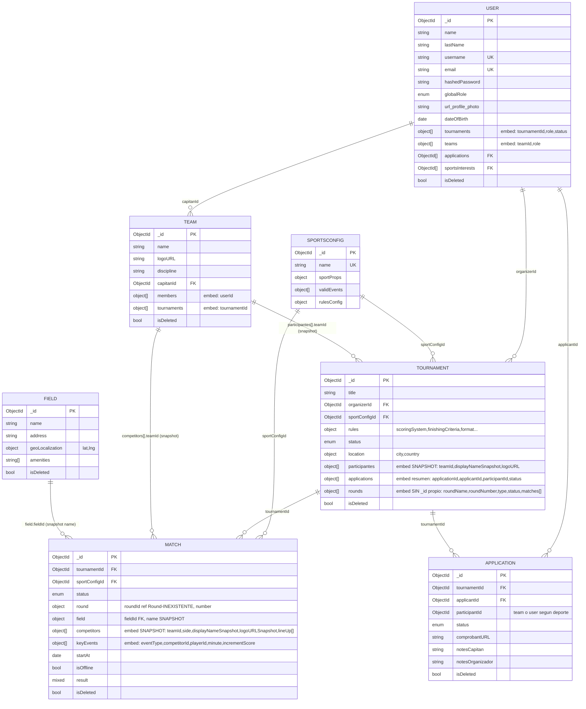

# TourneyFy — Modelo de Datos

Fuente de verdad: los schemas de Mongoose en `backend/src/models/*.js` (no el `.mml` viejo, que quedó desactualizado — ver nota al final). El schema de Dexie (`frontend/src/lib/db.js`) es un espejo parcial: mismos documentos, pero solo declara **índices**, no estructura — todo lo demás viaja embebido tal cual llega de la API.

## Diagrama entidad-relación (Mongo, 7 colecciones)



> Nota de lectura: las flechas "snapshot" no son referencias vivas de Mongo — son copias congeladas al momento de la inscripción/creación (ver ADR-006). El `ref: 'Round'` de `Match.round.roundId` está marcado como **inexistente** porque no hay modelo `Round` en el proyecto: las rondas viven embebidas dentro de `Tournament.rounds[]` y, además, ese subdocumento está declarado con `{ _id: false }`, por lo que hoy no tiene una identidad propia estable para que `Match.round.roundId` referencie (ver ADR-008, decisión abierta).

---

## Detalle por colección

### `SportsConfig` — el manifiesto multideporte
Es la pieza central del diseño polimórfico (ver ADR-005). No se crea desde la UI (sin endpoints de alta/edición expuestos ni pantalla); vive por seed.

- `sportProps`: `participantType` (INDIVIDUAL/TEAM), `minParticipants`, `maxParticipants`, `matchExecution` (VERSUS/LEADERBOARD), `scoringUnit`, `scoreOrder` (ASC/DESC), `finishCondition`, `hasDraw`.
- `validEvents[]`: catálogo de eventos posibles del deporte (`code`, `label`, `targetField`, `incrementScore`) — de acá salen los botones de carga de planilla (a futuro, hoy `TournamentStats` está sin implementar).
- `rulesConfig`: qué reglas de torneo soporta este deporte (`scoringSystem`, `finishingCriteria`, `subsLimit.max`, `tieBreakerRules`, `specialRules`, `format.allowed[]`). Diseñado para condicionar formularios (ej. `CreateTournament`), pero **hoy el formulario no lo consulta** (ver informe de pendientes).

### `User`
`tournaments[]` y `teams[]` son la forma en que el usuario "sabe" a qué pertenece, sin tener que hacer un `$lookup` inverso. `applications[]` referencia IDs de `Application` pero nada en el código hace `$push` sobre este array al crear una solicitud — queda desincronizado por diseño incompleto (no es grave porque nada lo lee hoy, pero conviene saberlo si se retoma el flujo de inscripciones).

### `Team`
`discipline` es un `String` libre, no un `ObjectId` a `SportsConfig` — se usa como texto para filtrar (`getTeamsByDiscipline`) y para mostrar (`SportsTag`). Funciona porque coincide con `sportConfigId` en la práctica, pero no hay integridad referencial real ahí.

### `Field` (canchas)
La colección más aislada del sistema: nada más la referencia salvo `Match.field.fieldId` (snapshot de `name`). Sin UI de gestión.

### `Tournament`
El documento más grande y con más responsabilidad. `rules` es un sub-objeto rico (sistema de puntos, criterio de desempate, formato, reglas especiales libres). `participantes[]` es el snapshot de quién juega; `rounds[]` es la estructura temporal/competitiva (ver ADR-007/008).

### `Match`
`round.number` (no `roundId`) es lo que efectivamente se usa para filtrar en la práctica (`getMatchesByTournamentAndRound`, índice compuesto `[tournamentId+round.roundId]` en Dexie — que en rigor debería llamarse `[tournamentId+round.number]` si `roundId` no es confiable; ver informe de errores). `competitors[]` soporta exactamente 2 elementos hoy (diseñado para `VERSUS`; `LEADERBOARD` no tiene aún una forma definida de listar N competidores con ranking).

### `Application`
Diseñada, con backend completo, sin consumo de frontend (ver informe de pendientes). `participantId` es deliberadamente ambiguo (puede ser un `teamId` o, a futuro, un `userId` si el deporte es `INDIVIDUAL`) — coherente con el diseño polimórfico, pero no hay ninguna lógica que hoy distinga el caso.

---

## Modelo de datos local (Dexie / IndexedDB)

```js
// frontend/src/lib/db.js — versión 2
{
  users:        '_id, email, globalRole',
  teams:        '_id, name, discipline, capitanId',
  sportsConfig: '_id, name',
  applications: '_id, tournamentId, applicantId, participantId, status',
  tournaments:  '_id, status, organizerId, sportConfigId, isDeleted, [status+isDeleted]',
  matches:      '_id, tournamentId, status, isDeleted, updatedAt, [tournamentId+round.roundId]',
  fields:       '_id, name',
  sync_queue:   'id, entity, action, status, createdAt',   // agregada en v2
}
```
Documento completo = mismo JSON que devuelve Mongo (mismo `_id` string como PK en ambos lados, sin transformación). Solo lo declarado arriba es indexable con `.where()`; el resto del documento (participantes, rounds, rules, keyEvents, etc.) viaja completo pero no es buscable directamente por Dexie.

---

## Sobre `gestorTorneos.mml`

El archivo original de MongoModeler quedó desactualizado (confirmado): sigue reflejando el primer boceto (`dates` en vez de `rounds`, `homeTeam`/`awayTeam` en vez de `competitors[]`, una colección `events` separada, `tournamentParticipant` como colección propia, `Tournaments.discipline` como enum, y sin colección `SportsConfig`). Se regeneró un `.mml` nuevo, fiel al estado actual de los modelos Mongoose, disponible como archivo separado (`gestorTorneos.regenerado.mml`) para importar directamente en MongoModeler y seguir iterando el diagrama visual desde ahí — incluyendo el sistema de colores por relación que se aportó al proyecto open source.
