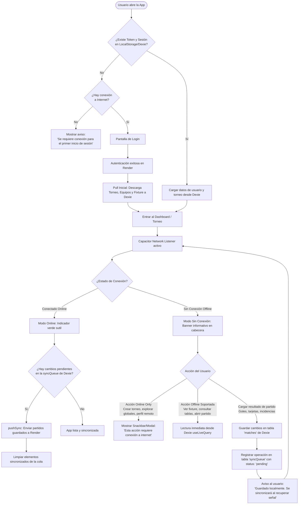

# CopaHub — Empaquetado Móvil con Capacitor y Arquitectura Offline-First

> **Fecha:** 02/11/2026  
> **Estado:** Fase 1 y 2 completadas (App empaquetada y corriendo en Android Studio). Planificación Offline-First lista para implementación.  
> **Área:** Frontend (`React 19 + Vite + Dexie + MUI`) / Móvil (`Capacitor 6+ Android`)

---

## 1. Registro de Cambios Técnicos Realizados

Se configuró el contenedor nativo de **Capacitor** sobre el frontend existente sin alterar la arquitectura base de React ni los estilos de Material UI:

### 1.1 Dependencias e Inicialización
* **Paquetes instalados:** `@capacitor/core`, `@capacitor/cli`, `@capacitor/android`.
* **Identificador de la App:** `com.copahub.app` (definido en `capacitor.config.json`).
* **Directorio Web:** Vinculado a `dist` (la salida de producción generada por `vite build`).
* **Plataforma nativa:** Inicializada la carpeta `frontend/android` con proyecto Gradle estándar.

### 1.2 Ajustes y Correcciones en Android
1. **Bypass de caracteres no-ASCII en ruta (`3er año`):**
   * *Problema:* El compilador Gradle de Android en Windows bloqueaba la compilación debido a la letra `ñ` en la ruta del repositorio (`...\3er año\...`).
   * *Solución:* Se añadió `android.overridePathCheck=true` en `frontend/android/gradle.properties`.
2. **Habilitación de tráfico Cleartext / HTTP:**
   * *Problema:* Las versiones modernas de Android bloquean por defecto cualquier conexión no cifrada (`http://`), impidiendo pruebas con servidores locales o proxies en desarrollo.
   * *Solución:* Se añadió `android:usesCleartextTraffic="true"` en la etiqueta `<application>` de `frontend/android/app/src/main/AndroidManifest.xml`.
3. **Viewport para dispositivos móviles:**
   * *Mejora:* Se actualizó la etiqueta meta en `frontend/index.html` a:
     ```html
     <meta name="viewport" content="width=device-width, initial-scale=1.0, viewport-fit=cover" />
     ```
     para permitir que la interfaz respete las áreas seguras (*safe areas*, notches y barras de navegación del sistema).
4. **Enrutamiento hacia el backend:**
   * *Problema:* Dentro de la WebView de Android, `localhost` apunta al propio teléfono (donde no corre ningún servidor), lo que arrojaba el error `Failed to fetch`.
   * *Solución:* Se configuró `VITE_APP_MODE=test` en `frontend/.env`, haciendo que la app móvil consuma directamente el backend desplegado en la nube:
     ```env
     VITE_APP_MODE=test
     VITE_API_BASE_URL_TEST=https://gestor-torneos.onrender.com/api
     ```
5. **Resolución de Safe Area Insets y Edge-to-Edge (Android 15+):**
   * *Problema:* En Android 15 (API 35+ / targetSdk 36), el sistema operativo fuerza el modo Edge-to-Edge por defecto. La interfaz web se renderizaba detrás de la barra de estado superior (hora, batería, íconos de red y recorte/notch de la cámara frontal) y por debajo de los 3 botones de navegación del sistema (`|||`, `O`, `<`). Además, el plugin `SystemBars` de Capacitor 8 delega los insets a Chromium WebView $\ge 140$ (aún no disponible en producción), asignando insets de `0px` a la WebView e ignorando el padding en `DecorView`.
   * *Solución:*
     * En `capacitor.config.json` se configuró `"insetsHandling": "disable"` para desactivar el comportamiento con insets en 0 del plugin interno.
     * En `MainActivity.java`, se implementó `ViewCompat.setOnApplyWindowInsetsListener` sobre el contenedor principal (`android.R.id.content`), calculando dinámicamente `WindowInsetsCompat.Type.systemBars() | WindowInsetsCompat.Type.displayCutout()`.
     * Se aplica padding superior (evitando la barra de estado y el notch de la cámara frontal) e inferior (salvando los 3 botones de navegación o barra de gestos, liberándolo cuando el teclado virtual `ime()` está activo).
     * Se fijaron los colores nativos de la barra de estado y de navegación en `#0a0a0a` con íconos claros (`isAppearanceLightStatusBars = false`), fusionando estéticamente la aplicación con el sistema.
6. **Contenedor nativo en Java:**
   * El archivo `MainActivity.java` fue provisto en Java dado que es la plantilla predeterminada creada por `@capacitor/cli` (`npx cap add android`). Su alcance está limitado a ser el cascarón o host nativo (~40 líneas) para iniciar la ventana y montar el WebView; la totalidad de la lógica de negocio y presentación de CopaHub continúa residiendo en React, Material UI y JavaScript.

---

## 2. Fundamentos del Funcionamiento Sin Conexión (Offline) en Capacitor

### ¿Por qué la app puede abrirse sin internet?
* En una web tradicional, el navegador necesita descargar el HTML y los scripts desde un servidor remoto cada vez que se ingresa.
* En **Capacitor**, todo el código transpilado (`dist/index.html`, bundles JS, CSS, imágenes y fuentes) se copia físicamente al compilar dentro de `android/app/src/main/assets/public`.
* Al tocar el icono de CopaHub en el teléfono, la WebView carga los archivos **desde el almacenamiento local del dispositivo**. La aplicación abre siempre, sin importar si hay señal de datos, Wi-Fi o modo avión activado.

### Persistencia de la Sesión
* Tanto `localStorage` como `IndexedDB` (**Dexie**) son persistentes dentro de la WebView de la app instalada.
* Una vez que el usuario se loguea, su token JWT y los datos de su entorno (torneos asignados, equipos y partidos) quedan almacenados en la base de datos local Dexie.
* Al abrir la app sin conexión, React lee la sesión existente y entra directamente a la vista principal sin exigir volver a loguearse.

---

## 3. Diagrama de Flujo — Experiencia Offline-First

El siguiente diagrama detalla la lógica de navegación, detección de conectividad y gestión de acciones según el estado de la red:



---

## 4. Implementación del Flujo de Sincronización y Red

Las siguientes capacidades fueron implementadas y verificadas:

1. **Plugin Nativo de Red (`@capacitor/network`):**
   * Instalado `@capacitor/network` y sincronizado en `frontend/android`.
   * Integrado en `OnlineContext.jsx` mediante `Network.addListener('networkStatusChange')` y `Network.getStatus()`, con fallback a los eventos nativos del navegador (`window.addEventListener('online'/'offline')`).
2. **Salvaguarda y Encolado en `updateMatchSheet`:**
   * *Diagnóstico:* Al guardar sin internet, `navigator.onLine` o `fetch()` arrojaba `Failed to fetch`. La excepción no era capturada, impidiendo que el código alcanzara el bloque `enqueue()`.
   * *Solución:* Se envolvió la llamada en `try/catch`. Ante cualquier error de red o conectividad, la planilla se almacena de inmediato en la tabla `matches` de Dexie y se encola automáticamente en `sync_queue` con acción `UPDATE_MATCH`.
3. **Manejo de Reintentos en `pushSync`:**
   * Las operaciones que sufren fallos de red transitorios ya no se marcan permanentemente como `FAILED` (lo que impedía su sincronización posterior), sino que regresan a estado `PENDING` mediante `markPending()`.
   * Al completarse la sincronización, se actualiza el partido y se refrescan las tablas y rondas del torneo en Dexie.
4. **Disparo Automático de Sincronización:**
   * Al abrir la app (montaje inicial en `OnlineContext`), si hay conexión y operaciones pendientes, se dispara `pushSync()` de inmediato.
   * Se ejecuta un ciclo de sondeo cada 10 segundos para vaciar la cola en segundo plano si hay conectividad.
   * Al detectar el evento de reconexión nativo, se dispara el vaciado inmediato.
5. **Protección en `userSync`:**
   * Antes de descargar los partidos del servidor, `userSync` intenta vaciar la cola local.
   * Si existen partidos locales con operaciones pendientes en `sync_queue`, no son pisados con los datos desactualizados del servidor hasta que su sincronización se complete.
