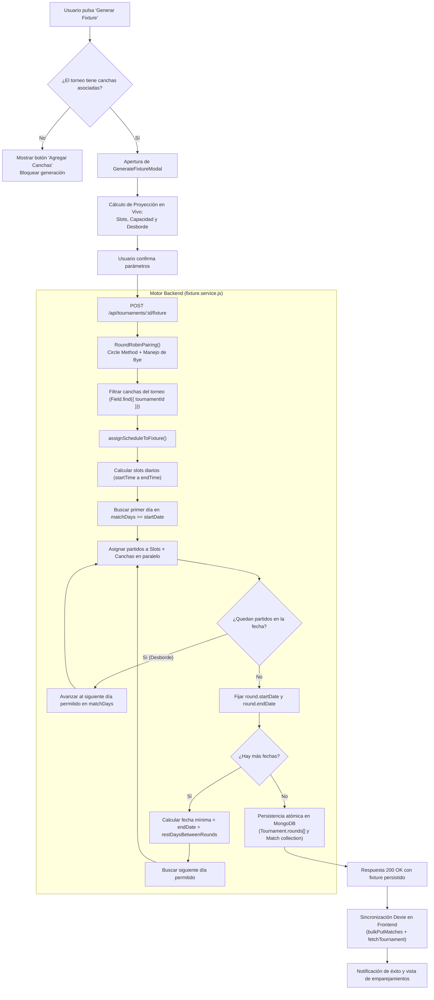

# Motor de Generación y Planificación de Fixture (TourneyFy)

Este documento detalla en profundidad la arquitectura, formulación matemática, algoritmo de asignación temporal y flujo operativo del motor de generación de fixture de TourneyFy (implementado bajo **ADR-018** y **ADR-019**).

---

## 1. Visión General y Objetivos de Diseño

El objetivo del motor es transformar un conjunto de participantes inscriptos en un calendario competitivo deportivo completo, viable en el mundo real y libre de colisiones físicas o de horario.

### Principios Fundamentales:
1. **Aislamiento Estricto por Torneo:** Cada torneo posee sus propias canchas/ubicaciones de juego (`Field.tournamentId`). No existen canchas compartidas implícitamente entre torneos; el administrador define la infraestructura física disponible para su certamen.
2. **Cero Colisiones Horarias:** Ninguna cancha puede albergar más de un partido a la misma hora. En cada turno horario se programan tantos partidos simultáneos como canchas habilitadas existan.
3. **Respeto a la Disponibilidad Física y de Agenda:** La disputa se restringe estrictamente a los días de la semana autorizados (`matchDays`) y dentro de la franja horaria establecida (`startTime` a `endTime`).
4. **Política de Desborde Continuo (Overflow):** Si la cantidad de partidos de una fecha supera la capacidad de un día de juego, los partidos restantes se programan en el siguiente día permitido más próximo, manteniéndose dentro de la misma jornada deportiva.
5. **Garantía de Descanso Inter-Jornadas:** Una nueva jornada no puede comenzar hasta que hayan transcurrido los días mínimos de descanso estipulados tras la finalización del último partido de la fecha anterior.
6. **Bloqueo Preventivo sin Canchas:** No es posible generar un fixture si el torneo no cuenta con al menos una cancha registrada. La interfaz guía directamente al usuario mediante el botón **"Agregar Canchas"**.

---

## 2. Parámetros del Algoritmo

El generador recibe como entrada las siguientes variables, provistas por la configuración del torneo o ajustadas por el organizador en el modal de generación:

| Parámetro | Tipo | Descripción | Default / Restricción |
|---|---|---|---|
| `participants` | `Array<Object>` | Lista de competidores (`participantId`, `teamId`, `displayNameSnapshot`, `logoURL`). | Mínimo 2 participantes. |
| `rounds` | `String` | Formato de ruedas: `'single'` (solo ida) o `'double'` (ida y vuelta). | `'single'` |
| `startDate` | `Date` / `String` | Fecha base a partir de la cual puede disputarse la Jornada 1. | Fecha de inicio del torneo o `Date.now()`. |
| `matchDays` | `Array<Number>` | Días de la semana habilitados (`0` = Domingo, `1` = Lunes, ..., `6` = Sábado). | `[6, 0]` (Sábados y Domingos). Mínimo 1 día. |
| `startTime` | `String` | Hora de apertura de la franja diaria (`'HH:mm'`). | `'14:00'` |
| `endTime` | `String` | Hora de cierre límite de la franja diaria (`'HH:mm'`). | `'21:00'` (debe ser posterior a `startTime`). |
| `slotDurationMinutes` | `Number` | Duración del turno por partido (tiempo neto + márgenes de descanso/limpieza de cancha). | `90` min. Mínimo mayor a 0. |
| `restDaysBetweenRounds` | `Number` | Cantidad de días de descanso requeridos entre el fin de una fecha y el inicio de la siguiente. | `6` días (mínimo 0). |
| `fieldIds` | `Array<String>` | IDs de las canchas asignadas exclusivamente a este torneo que se utilizarán en el fixture. | Todas las canchas activas del torneo (`tournamentId`). Mínimo 1. |

---

## 3. Fase 1: Emparejamiento Deportivo (Round Robin / Circle Method)

Implementado en `RoundRobinPairing` (`fixture.service.js` y `ROUND_ROBIN.js`).

### Formulación Matemática:
Dado un número de participantes $N$:

1. **Ajuste por Imparidad:**
   * Si $N$ es impar, se añade un elemento ficticio denominado `bye` (`null`):
     $$N' = N + 1$$
   * Si $N$ es par:
     $$N' = N$$

2. **Cálculo de Fechas y Partidos:**
   * Cantidad de fechas por rueda (ida):
     $$R_{\text{ida}} = N' - 1$$
   * Partidos máximos por fecha:
     $$M_{\text{fecha}} = \lfloor N / 2 \rfloor$$

3. **Rotación del Círculo (Circle Method / Tablas de Berger):**
   * Se indexan los participantes en una lista: $[P_0, P_1, P_2, \dots, P_{N'-1}]$.
   * En cada ronda $r \in [0, R_{\text{ida}}-1]$:
     * Para cada par $i \in [0, N'/2 - 1]$:
       $$\text{Local} = P_i, \quad \text{Visitante} = P_{N'-1-i}$$
     * **Regla del Bye:** Si alguno de los dos participantes es el `bye`, ese enfrentamiento no se crea: el participante restante queda en condición de **"libre" (descansa en esa fecha)**.
     * **Rotación:** El elemento $P_0$ se mantiene fijo. El último elemento se extrae y se inserta en la posición 1, desplazando el resto a la derecha:
       $$[P_0, P_{N'-1}, P_1, P_2, \dots, P_{N'-2}]$$

4. **Doble Rueda (Ida y Vuelta):**
   * Si `rounds === 'double'`, se duplican las jornadas invirtiendo rigurosamente la condición de local y visitante:
     $$\text{Partido}_{\text{vuelta}} = \{\text{home}: \text{away}_{\text{ida}}, \text{away}: \text{home}_{\text{ida}}\}$$
   * La numeración de las fechas de la vuelta continúa correlativamente: $R_{\text{vuelta}, k} = R_{\text{ida}} + k$.

---

## 4. Fase 2: Planificación Temporal y Asignación de Canchas (`assignScheduleToFixture`)

Una vez obtenidos los emparejamientos teóricos, el algoritmo distribuye los partidos en el tiempo y en el espacio físico.

### Paso 2.1: Cálculo de los Turnos Horarios Diarios
La ventana de tiempo disponible por día se calcula transformando los horarios a minutos desde la medianoche:
$$T_{\text{start}} = H_{\text{start}} \times 60 + M_{\text{start}}$$
$$T_{\text{end}} = H_{\text{end}} \times 60 + M_{\text{end}}$$
$$\text{Ventana Total (min)} = T_{\text{end}} - T_{\text{start}}$$

Se generan los turnos discretos:
$$\text{Slots} = \{ m \mid m = T_{\text{start}} + k \cdot \text{slotDurationMinutes}, \quad m + \text{slotDurationMinutes} \le T_{\text{end}} \}$$

Cada slot $m$ define una hora y minuto de inicio:
$$\text{hora} = \lfloor m / 60 \rfloor, \quad \text{minuto} = m \bmod 60$$

### Paso 2.2: Capacidad Diaria
Dada una cantidad de canchas disponibles $C = |\text{fields}|$ y una cantidad de turnos diarios $K = |\text{Slots}|$:
$$\text{Capacidad Diaria} = K \times C \text{ partidos/día}$$

En cada turno horario se pueden disputar simultáneamente hasta $C$ partidos (uno por cada cancha).

### Paso 2.3: Determinación del Día Calendario Válido
Función auxiliar `getNextMatchDay(fechaBase, matchDays)`:
* Evalúa el día de la semana de `fechaBase` (`date.getDay()`).
* Si pertenece a `matchDays`, se utiliza esa fecha.
* De lo contrario, incrementa día a día hasta hallar la primera fecha cuyo día coincida con `matchDays`.

### Paso 2.4: Bucle de Jornadas y Desborde Automático
Para cada jornada $J \in \text{fixture}$:

1. **Fecha de Inicio de la Jornada:**
   * **Para la Jornada 1:** El primer día válido a partir de `startDate`:
     $$\text{DíaInicial}_1 = \text{getNextMatchDay}(\text{startDate}, \text{matchDays})$$
   * **Para Jornadas Subsiguientes ($J > 1$):** Se toma la fecha en que culminó el último partido de la jornada anterior ($J-1$) y se adicionan los días de descanso:
     $$\text{FechaMinima}_J = \text{endDate}_{J-1} + \text{restDaysBetweenRounds} \text{ días}$$
     $$\text{DíaInicial}_J = \text{getNextMatchDay}(\text{FechaMinima}_J, \text{matchDays})$$

2. **Asignación de Partidos a Slots y Canchas:**
   * Se inicializa la cola de partidos pendientes de la fecha: $Q = [\text{partido}_1, \text{partido}_2, \dots]$.
   * Mientras $Q$ no esté vacía:
     * Para cada `slot` en `Slots`:
       * Para cada `field` en `fields`:
         * Si $Q$ está vacía, se interrumpe el ciclo.
         * Se extrae el siguiente partido $p = Q.\text{shift}()$.
         * Se construye la fecha y hora exacta del partido:
           $$\text{startAt} = \text{DíaActual} + \text{slot.hora} + \text{slot.minuto}$$
         * Se asigna al partido:
           $$p.\text{field} = \{\text{fieldId}: \text{field}._id, \text{name}: \text{field}.\text{name}\}$$
           $$p.\text{startAt} = \text{startAt}$$
         * Se actualizan `round.startDate` y `round.endDate` con los extremos temporales observados.
     * **Mecanismo de Desborde (Overflow):**
       * Si tras agotar todos los slots del `DíaActual` aún restan partidos en $Q$, se avanza al siguiente día permitido:
         $$\text{DíaActual} = \text{getNextMatchDay}(\text{DíaActual} + 1 \text{ día}, \text{matchDays})$$
       * El bucle continúa en el nuevo día, consumiendo nuevamente los slots desde el primero hasta agotar $Q$.

---

## 5. Diagrama de Flujo del Algoritmo



---

## 6. Fase 3: Persistencia Atómica en Base de Datos

Para asegurar la integridad referencial conforme a **ADR-008** y **ADR-019**:

1. **Pre-generación de IDs de Ronda:**
   Antes de insertar los partidos, se generan los `ObjectId` de cada jornada:
   ```javascript
   const roundIds = fixture.map(() => new mongoose.Types.ObjectId());
   ```
2. **Construcción de Partidos (`Match`):**
   Cada partido enlaza su jornada mediante:
   ```javascript
   matchDoc.round = { roundId: roundIds[roundIndex], number: round.roundNumber };
   matchDoc.field = { fieldId: field._id, name: field.name };
   ```
3. **Transacción Mongoose:**
   * Se insertan en lote los partidos (`Match.insertMany(matchDocs, { session })`).
   * Se actualizan las rondas embebidas en `Tournament.rounds[]` con los `_id` pre-generados y el arreglo de IDs de sus partidos correspondientes (`matches: matchIds`).
   * Se persisten en `Tournament.scheduleConfig` los parámetros utilizados (`matchDays`, `startTime`, `endTime`, `slotDurationMinutes`, `restDaysBetweenRounds`, `fieldIds`).
   * Se actualiza `Tournament.rules.rounds` con `'single'` o `'double'`.
   * En entornos de desarrollo sin replica set, se cuenta con un fallback atómico compensatorio con rollback en bloque.

---

## 7. Fase 4: Experiencia de Usuario y Manejo de Errores

### Estado "Sin Canchas Registradas":
* Si el torneo tiene 0 canchas en Dexie/MongoDB:
  * La tarjeta de Fixture en `TournamentAdminSettings.jsx` reemplaza el botón "Generar Fixture" por **"Agregar Canchas"** (con color primario e ícono `StadiumIcon`).
  * Al hacer clic, navega inmediatamente a `/torneos/:id/canchas`.
  * La descripción advierte: *"Antes de generar el fixture tenés que agregar al menos una cancha para disputar los encuentros."*

### Modal de Parametrización (`GenerateFixtureModal.jsx`):
* **Chips interactivos para Días:** Selección rápida de Lunes a Domingo.
* **Selectores de Tiempo y Turno:** Validaciones en tiempo real para impedir horas invertidas o franjas más cortas que el turno.
* **Selector Dinámico de Canchas:** Checkboxes individuales con selector global "Seleccionar todas / Deseleccionar todas".
* **Panel de Métricas en Vivo:**
  * Partidos por jornada ($M$).
  * Total de fechas y partidos de la competición.
  * Turnos por día ($K$).
  * Capacidad diaria ($K \times C$).
  * Mensaje predictivo:
    * Si $\text{Capacidad} \ge M$: *"Cada jornada de M partidos se completará en 1 solo día de juego con C canchas en simultáneo."*
    * Si $\text{Capacidad} < M$: *"Por capacidad horaria, cada jornada de M partidos se repartirá a lo largo de D días de juego permitidos consecutivos."*

---

## 8. Ejemplo Práctico de Asignación

### Datos del Torneo:
* **Participantes (5 equipos):** Halcones, Tiburones, Leones, Águilas, Panteras.
* **Canchas (2):** Cancha 1 y Cancha 2.
* **Días de juego:** Sábados y Domingos (`matchDays = [6, 0]`).
* **Franja Horaria:** 14:00 a 17:00 hs (180 minutos).
* **Duración del Turno:** 90 minutos.
  * Turno 1: 14:00 hs.
  * Turno 2: 15:30 hs.
  * *Slots por día: 2 turnos.*
  * *Capacidad por día:* $2 \text{ turnos} \times 2 \text{ canchas} = 4 \text{ partidos/día}$.
* **Descanso entre fechas:** 5 días.
* **Fecha de inicio:** Sábado 07/11/2026.

### Ejecución:
1. **Ronda 1 (Fecha 1):**
   * Participantes impares (5): se agrega el `bye`. Total 6 competidores virtuales $\rightarrow$ 3 partidos calculados, 1 es contra el `bye` (un equipo queda libre). Restan **2 partidos reales** en la Fecha 1.
   * Como caben 4 partidos por día y son 2:
     * 14:00 hs $\rightarrow$ Partido 1 en Cancha 1.
     * 14:00 hs $\rightarrow$ Partido 2 en Cancha 2.
   * `round.startDate` = 07/11/2026 14:00 hs.
   * `round.endDate` = 07/11/2026 14:00 hs.
2. **Cálculo de Descanso:**
   * Fin de Fecha 1: Sábado 07/11/2026.
   * Descanso requerido: 5 días $\rightarrow$ Fecha mínima = Jueves 12/11/2026.
   * Próximo día válido en `[6, 0]`: **Sábado 14/11/2026**.
3. **Ronda 2 (Fecha 2):**
   * Se programa el Sábado 14/11/2026 a partir de las 14:00 hs.
   * Y así sucesivamente hasta completar las 5 fechas del certamen.

---

## 9. Historial de Decisiones Relacionadas

* **ADR-008:** Identidad de las rondas como subdocumentos embebidos con `_id` propio.
* **ADR-018:** Gestión de espacios de juego por torneo con nomenclatura dinámica por deporte.
* **ADR-019:** Parametrización del fixture con turnos sin colisiones, desbordes y descansos inter-jornadas.
